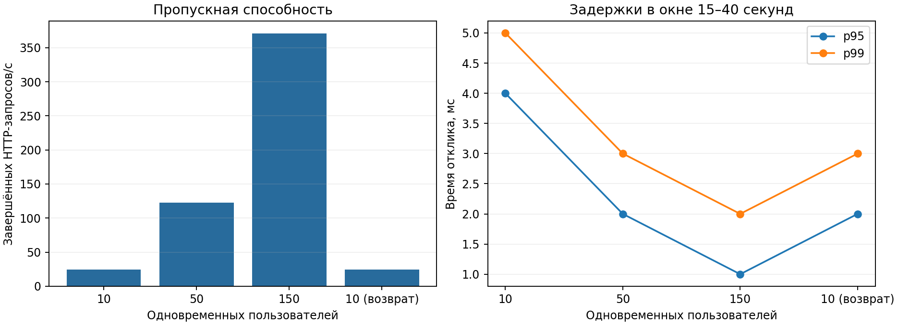

# Отчёт: нагрузочное тестирование API в Apache JMeter

**Дисциплина:** Управление производительностью приложений. **Домашнее задание по теме 3.**

**Дата:** 21 ноября 2026 года. **Часовой пояс:** Europe/Samara, UTC+4.

**Результат:** в четырёх основных фазах выполнено **21 620 запросов без ошибок**. При 150 пользователях достигнуто 370,72 запроса/с в стабильном окне, p95 — 1 мс. Насыщение сервиса не обнаружено; это результат конкретного локального сценария, а не максимальная производительность приложения.

## Сервис и инструменты

Разработан [API задач](../src/main/java/ru/study/loadlab/) на Spring Boot 3.5.16, Java 17.0.19 (Amazon Corretto), JDBC и H2 in-memory. Контроллер разбирает и проверяет запросы, сервис выполняет операции в транзакциях, репозиторий обращается к H2. База содержит 200 исходных задач и временные записи пользователей теста. Пул Hikari ограничен 10 соединениями.

Нагрузка создана **Apache JMeter 5.6.3** в CLI. Метрики собирались через **Actuator/Micrometer**, профиль — через **JFR и jcmd**. Приложение и JMeter работали на одном компьютере macOS 27.2.1 ARM64, 10 логических CPU; каждому процессу заданы `-Xms256m -Xmx512m`. [Параметры среды](../results/environment.json). Локальные HTTP-запросы не включают задержку внешней сети; H2 не моделирует дисковую производственную БД.

## Сценарий и проверки

Файлы для воспроизведения: **[task-lifecycle.jmx](../load/task-lifecycle.jmx)** и **[users.csv](../load/users.csv)**. Инструкция запуска приведена в [README](../README.md).

Каждый виртуальный пользователь выполняет цикл из шести HTTP-запросов:

| Операция | Ожидаемый код | Что проверяется |
|---|---:|---|
| GET списка | 200 | JSON-массив items, limit/offset, статус, приоритет, подстрока поиска и порядок id |
| POST задачи | 201 | Положительный id, отправленные title/priority, начальный статус OPEN |
| GET созданной задачи | 200 | Полученный из POST id и сохранённые значения |
| PUT изменения | 200 | Новый title/priority, статус DONE |
| GET после изменения | 200 | Изменения действительно сохранились |
| DELETE своей задачи | 204 | Пустой ответ и успешное удаление |

ID из ответа POST передаётся следующим запросам через переменную `taskId`. Проверки реализованы JSR223 Assertion на Groovy. Некорректный статус, JSON или содержимое помечают запрос как неуспешный; пользователь останавливается, чтобы не создавать каскад ошибок. Наличие записи после удаления дополнительно проверяется HTTP-тестом приложения.

CSV содержит восемь наборов категорий, приоритетов и статусов. В заголовок создаваемой задачи добавляется UUID; изменяются фильтры, размер страницы 10/20 и смещение 0/10/20. Пользователи не обновляют одну общую запись. Перед каждым запросом стоит случайная пауза **200–600 мс**, включён HTTP Keep-Alive. Это ускоренная модель полного рабочего цикла с 50% чтений и 50% операций записи, включая очистку.

## План опыта

Сначала выполнена отрицательная проверка: priority=0 вызвал HTTP 400, и JMeter корректно зафиксировал одну ошибку assertion вместо ожидаемого 201. Эта фаза не входит в показатели нагрузки. Затем проведён прогрев: 10 пользователей, 20 секунд.

Основные фазы: **10 → 50 → 150 → 10 пользователей**, каждая длительностью 45 секунд с ramp-up 10 секунд. Последняя фаза проверяет поведение после пика. Перед следующей фазой удалялись незавершённые `load-...` задачи и выдерживалась пауза 3 секунды. После всего опыта в БД снова осталось **200 исходных записей**. Остановка по расписанию может оборвать цикл между POST и DELETE; служебная очистка учитывается отдельно и не входит в JTL.

Для сравнения выбрано одинаковое окно **15–40 секунд от первого HTTP-запроса фазы**. Throughput — число завершений в этом окне, делённое на 25 секунд. Задержка — `elapsed` в JMeter; пауза пользователя в неё не входит. p95/p99 рассчитаны по nearest rank. JTL имеет разрешение в миллисекундах, поэтому значения 0 мс означают округлённые короткие запросы.

## Измерения

Число запросов и ошибки ниже относятся ко всей фазе; задержки и throughput — к стабильному окну.

| Пользователей | Запросов за фазу | Запросов в окне | Запросов/с | Среднее, мс | p95, мс | p99, мс | Ошибок за фазу |
|---|---:|---:|---:|---:|---:|---:|---:|
| 10 | 982 | 609 | 24,36 | 2,42 | 4 | 5 | 0 |
| 50 | 4 916 | 3 061 | 122,44 | 0,98 | 2 | 3 | 0 |
| 150 | 14 739 | 9 268 | 370,72 | 0,50 | 1 | 2 | 0 |
| 10, после пика | 983 | 608 | 24,32 | 1,37 | 2 | 3 | 0 |

p95 ключевых операций, мс:

| Операция | 10 пользователей | 50 | 150 | 10 после пика |
|---|---:|---:|---:|---:|
| GET списка | 3 | 2 | 1 | 2 |
| POST создания | 4 | 2 | 1 | 2 |
| GET созданной задачи | 3 | 2 | 1 | 2 |
| PUT обновления | 5 | 2 | 1 | 3 |
| GET после обновления | 3 | 2 | 1 | 2 |
| DELETE | 3 | 2 | 1 | 2 |

В стабильном окне максимум задержки составил 27 / 42 / 5 / 3 мс соответственно. На фазе 50 пользователей были отдельные выбросы, однако p99 остался 3 мс. Данных недостаточно, чтобы приписать эти выбросы конкретному ресурсу. Снижение задержек на последующих фазах совместимо с прогревом JVM и кэшей, но причинность отдельно не проверялась. Нельзя делать вывод «чем больше пользователей, тем быстрее сервис».

[Полная статистика](../results/summary.json), [результаты по операциям](../results/endpoints.csv). Оригинальные JTL: [10 пользователей](../results/baseline/requests.jtl), [50](../results/medium/requests.jtl), [150](../results/peak/requests.jtl), [после пика](../results/recovery/requests.jtl).

Готовые **JMeter HTML Dashboard**: [10 пользователей](../results/baseline/dashboard.zip), [50](../results/medium/dashboard.zip), [150](../results/peak/dashboard.zip), [после пика](../results/recovery/dashboard.zip). Скачайте архив, распакуйте и откройте `index.html`; там есть статистика, графики задержек, throughput и активных потоков. Dashboard считает весь запуск, включая разгон, поэтому его средние отличаются от таблицы стабильного окна.

## Мониторинг и профиль

Actuator опрашивался каждые 2 секунды. Максимальные **снятые** значения used heap в окнах: 153,61 / 155,12 / 166,57 / 143,97 МиБ. Максимум `process.cpu.usage` среди этих окон — 0,0371 (3,71% в шкале метрики). `hikaricp.connections.pending` во всех снятых показаниях равен 0. Редкий опрос может пропустить короткие всплески и ожидания: эти показатели не доказывают их полного отсутствия. [Сырые показатели пика](../results/peak/monitor.json).

Перед пиком запущен JFR `settings=profile` на 55 секунд; запись включает также короткий переход после нагрузки. Получено **104 ExecutionSample** и **3 young GC**, суммарная длительность GC-пауз — **9,379 мс**, максимальная — **3,935 мс**. В выборках встречаются обработка HTTP, операции строк и коллекций, JDBC/H2 и JSON. Самые частые верхние кадры стека встретились лишь по 5 раз; этого недостаточно для заявления о доказанном CPU bottleneck. [Сводка JFR](../results/jfr-summary.txt), [агрегат](../results/jfr-analysis.json), [исходные события JSON.gz](../results/jfr-events.json.gz).

## Аналитический вывод

В проверенном диапазоне API сохранял корректность чтений и записей, не возвращал неожиданных ошибок и не показал устойчивого роста задержек. После пика throughput при 10 пользователях вернулся практически к исходному значению. Четыре HTTP-теста приложения также прошли: [результаты](../results/tests.txt).

Предел мощности не найден: при среднем think time 0,4 с ориентир для 150 пользователей — `150 / 0,4 ≈ 375 запросов/с`, близко к измеренным 370,72. Это **замкнутая модель нагрузки**, где пользователи ждут ответа и затем делают паузу. При замедлении системы она может снижать интенсивность и скрывать перегрузку. Один запуск каждого уровня, маленькая in-memory БД, общая машина и короткая длительность ограничивают переносимость выводов.

Срочных оснований менять код по этому опыту нет. Следующие проверки: увеличить объём данных, повторить уровни в другом порядке, продлить нагрузку, вынести JMeter на отдельный компьютер и проверить заданную интенсивность поступления запросов. При росте таблицы стоит измерить поиск `LOCATE(..., LOWER(title))`: это поиск подстроки, который обычный индекс по title сам по себе не ускорит. Изменять индексы, SQL или размер пула следует после подтверждения проблемы профилем и планом запроса.

## Самопроверка

- [x] Использованы GET, POST, PUT и DELETE.
- [x] Проверяются HTTP-коды, JSON и сохранённые значения; проверка ошибок испытана отрицательным тестом.
- [x] Thread Group моделирует несколько пользователей с плавным запуском.
- [x] Входные данные меняются через CSV, UUID и переменные.
- [x] Выполнены реальные измерения; сохранены `.jmx`, исходные результаты и аналитический отчёт.
- [ ] Ссылку на отчёт нужно самостоятельно прикрепить в личном кабинете курса.

## Документация

- [JMeter: Best Practices](https://jmeter.apache.org/usermanual/best-practices.html) — запуск нагрузки в CLI и ограничения модели.
- [JMeter: компоненты](https://jmeter.apache.org/usermanual/component_reference.html) — Thread Group, CSV Data Set, таймеры и JSR223 Assertion.
- [JMeter: HTML Dashboard](https://jmeter.apache.org/usermanual/generating-dashboard.html) — генерация отчётов.
- [Oracle: jfr](https://docs.oracle.com/en/java/javase/17/docs/specs/man/jfr.html) — сводка и экспорт профиля.
